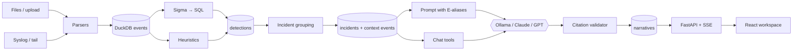

# Log Whisperer

Turns raw security logs into an attack timeline you can check. Detections come from Sigma rules and heuristics, an LLM explains each incident step by step, and **every sentence cites the log lines that prove it**. Sentences the logs don't support are dropped before you see them.

Built for junior analysts and small teams who have Windows event logs, Linux `auth.log` and web server logs, and need to know what happened, in what order, mapped to MITRE ATT&CK.

```
14:02:01  203.0.113.7 brute-forced root over SSH (13 failures)        [T1110.001]  ▲1 ×13
14:09:12  It logged in as root from the same address                    [T1078]      ▲2
14:11:31  The attacker created user "backdoor" and added it to sudo     [T1136.001]  ▲3 ▲4
14:14:02  backdoor read /etc/shadow and downloaded x.sh via sudo        [T1003.008]  ▲5
```
Each ▲ is an evidence marker; in the UI it opens the raw log line, its file and record number.

## What it does

| | |
|---|---|
| **Ingest** | Windows EVTX (Security, Sysmon, PowerShell), Windows JSON exports (Security-Datasets/Mordor, Winlogbeat), Linux `auth.log`, Apache/Nginx access logs, `.gz` files; live syslog (UDP/TCP, RFC 3164/5424) and file tailing |
| **Detect** | ~2,200 SigmaHQ rules compiled to DuckDB SQL by a custom pySigma backend, plus heuristics: brute force, impossible travel (GeoIP), new admin user, suspicious PowerShell |
| **Group** | Detections that share a host, user or IP within 30 minutes become one incident, across log sources (a web SQL injection and the SSH login that followed land in the same incident) |
| **Explain** | Cited narrative per incident, ATT&CK table, chat ("Which hosts did this IP touch?") that answers through safe query tools and also cites |
| **Respond** | Suggested response actions (cited, never executed), a Sigma rule draft that is tested against the incident before it is saved, Markdown/PDF reports |
| **Measure** | `logw eval` scores narratives per model: citation validity, entity grounding, ATT&CK precision/recall, key-fact recall |

## The trust feature: citations the model can't fake

The model never sees raw event IDs. It sees compact lines labelled `E1, E2, …` and must return JSON where every step lists the aliases that support it. A deterministic validator (`narrative/validator.py`) then:

1. rejects steps with no citations or with aliases that don't exist;
2. rejects steps whose timestamp doesn't match the cited events;
3. rejects steps that mention an IP, host or user that is not in the cited events (`ungrounded_entity`);
4. strips ATT&CK IDs that don't exist and maps revoked ones to their replacement.

Dropped statements are kept and shown separately ("3 statements were dropped because the logs don't support them"), so the analyst can see what the model tried to claim. Chat answers, response actions and rule drafts go through the same checks. Log content is treated as untrusted input in every prompt.

## Architecture



- **Backend:** Python 3.12, FastAPI, DuckDB (one process owns the file; live ingestion runs inside it), pySigma, pyevtx-rs.
- **LLM:** provider interface with Ollama (default, local), Anthropic (`claude-opus-5-5`) and OpenAI adapters.
- **Frontend:** React, TypeScript, Vite, Tailwind, TanStack Query; types generated from the OpenAPI schema.

Design decisions and their reasons: [docs/DESIGN.md](docs/DESIGN.md). Build plan: [docs/ROADMAP.md](docs/ROADMAP.md).

## Quick start

On Windows, `runner.bat` does everything: it checks Docker and Ollama, picks an installed model, builds and starts the stack, waits until it's healthy and opens the UI.

```bat
runner.bat          :: Docker (UI http://localhost:8080)
runner.bat local    :: without Docker: API + Vite dev server in two windows (UI http://localhost:5173)
runner.bat stop     :: stop the Docker stack (data is kept)
runner.bat logs     :: follow container logs
```

Set `LOGW_OLLAMA_MODEL` to choose the model, or `LOGW_LLM_PROVIDER=anthropic` (with `ANTHROPIC_API_KEY`) to use Claude.

Manual setup — requirements: Python 3.12 + [uv](https://docs.astral.sh/uv/), Node 24, and [Ollama](https://ollama.com) for local models.

```bash
# backend
cd backend
uv sync
uv run logw rules sync                       # pinned SigmaHQ snapshot -> ../rules/sigma
uv run python ../scripts/fetch_geoip.py      # optional: DB-IP Lite for impossible travel
ollama pull gemma4:26b-a4b                   # or set [llm] ollama_model in config.toml

# try it from the command line
uv run logw ingest tests/fixtures/auth.log tests/fixtures/access.log
uv run logw detect
uv run logw incidents
uv run logw narrate <incident-id>
uv run logw chat <incident-id>

# web UI
uv run logw serve                            # API on :8000, docs at /api/docs
cd ../frontend && npm install && npm run dev # UI on http://localhost:5173
```

Or with Docker (Ollama stays on the host so it can use your GPU):

```bash
docker compose up --build                    # UI on http://localhost:8080, syslog on :5514
```

Hosted models: set `ANTHROPIC_API_KEY` or `OPENAI_API_KEY` (see `backend/.env.example`) and pick the provider in the UI or with `--provider`.

## Privacy: local vs hosted models

Logs contain usernames, hostnames, internal IPs and sometimes credentials in command lines. The default provider is **Ollama**, so nothing leaves the machine. Hosted models (Claude, GPT) write noticeably better timelines, but the incident's context events are sent to the provider. Only the selected incident's events (capped at 300, repetitive ones collapsed) are sent, never the whole database. The choice is per request. Running `logw eval` for each provider puts the quality difference into numbers, so the trade-off is explicit.

## Evaluation

`logw eval` runs every case in `eval/cases/`: it ingests the files, detects, groups, generates a narrative for the main incident and scores it.

- **Step validity:** share of narrative steps that pass the validator.
- **Entity grounding:** share of steps not dropped for naming something absent from their evidence.
- **ATT&CK precision / recall:** narrative techniques vs the dataset's documented techniques (parent/sub-technique counts half).
- **Key-fact recall:** hand-labelled facts (entity, action, approximate time) that the narrative cites.

Cases: 2 synthetic stories (SSH brute force → backdoor user; SQL injection → SSH), 4 Security-Datasets recordings (Mimikatz, SAM copy, PS remoting, BITS download) and 4 EVTX-ATTACK-SAMPLES files (impacket wmiexec, IIS web shell, Kerberos spray, Guest added to Administrators).

### Results (local Gemma 4 26B-A4B via Ollama, RTX 5050 8 GB, 2026-10-23)

| Case | Step validity | Grounding | ATT&CK P | ATT&CK R | Key facts |
|---|---|---|---|---|---|
| ssh-bruteforce-new-user | 100% | 100% | 100% | 100% | 100% |
| web-sqli-to-ssh | 80% | 80% | 100% | 75% | 50% |
| sd-mimikatz-logonpasswords | 100% | 100% | 33% | 50% | 50% |
| sd-sam-copy-esentutl | 100% | 100% | 50% | 100% | 100% |
| sd-psremoting | 100% | 100% | 40% | 100% | 100% |
| sd-bitsadmin-download | 100% | 100% | 50% | 100% | 100% |
| evtx-wmiexec-impacket | 100% | 100% | 29% | 100% | 100% |
| evtx-iis-webshell | 100% | 100% | 67% | 100% | 100% |
| evtx-kerberos-spray | 100% | 100% | 25% | 50% | 100% |
| evtx-guest-to-admins | 100% | 100% | 50% | 100% | 100% |
| **Average** | **98%** | **98%** | **54%** | **88%** | **90%** |

How to read it:
- **Citations hold up.** 98% of steps survive validation. The rejected 2% are real ungrounded claims (an IP or user the cited events don't contain), caught before display.
- **Recall is high, precision is low.** The model tags extra techniques, often ones that Sigma detections in the same incident legitimately point to (e.g. T1033 discovery around a web shell) but that the dataset's single label doesn't list. Part of that is strict labelling, part is over-tagging.
- **Hardest cases:** Mimikatz, where LSASS access is buried among 6,000 events, and the cross-source web→SSH story.

Hosted models haven't been run yet; `logw eval --provider anthropic` adds a row to `eval/results/SUMMARY.md`.

Results are appended to `eval/results/SUMMARY.md` on every run.

## Datasets

```bash
python scripts/fetch_datasets.py   # -> datasets/ (git-ignored, re-runs skip what exists)
```

- [EVTX-ATTACK-SAMPLES](https://github.com/sbousseaden/EVTX-ATTACK-SAMPLES) (GPL-3.0), downloaded, not redistributed
- [Security-Datasets](https://github.com/OTRF/Security-Datasets) (MIT), a selection of Windows host recordings

Some recordings contain real attack payloads; endpoint antivirus may quarantine them on download. That's expected, and the fetch list avoids the ones that triggered Defender during development.

## Development

```bash
cd backend && uv run pytest          # 240+ tests, no network; live LLM tests: -m live
cd frontend && npm test && npm run build
cd frontend && npm run gen:api       # regenerate API types after backend changes
```

## Known limits

- Detection planning cost: running ~2,200 Sigma rules costs about 5 s per detection pass even for a handful of new events, which bounds live-mode latency.
- Sigma correlation rules (`count()`, temporal) are not supported; they are reported by `logw rules check`.
- Only the largest incident per eval case is scored.
- PDF export needs GTK/Pango (present in the Docker image; on bare Windows use Markdown export).

## Licenses

Code: MIT. Bundled SigmaHQ rules: [Detection Rule License 1.1](rules/sigma/LICENSE). GeoIP: [DB-IP Lite](https://db-ip.com) (CC BY 4.0, IP geolocation by DB-IP). ATT&CK® is a registered trademark of The MITRE Corporation; the technique catalog is generated from [MITRE CTI](https://github.com/mitre/cti).
